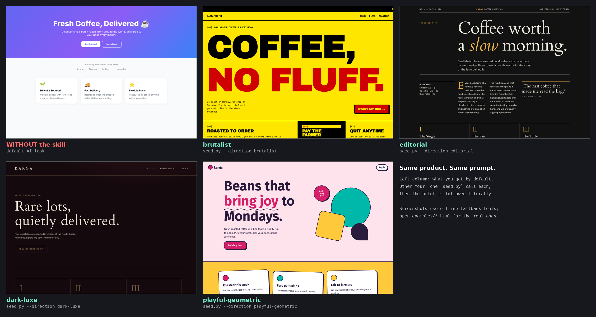

# design-variety

[](https://github.com/cumalibilgic/design-variety/actions/workflows/test.yml)

**Stop AI-built UIs from all looking the same.**



Left alone, AI coding assistants converge on one look: purple-blue gradient, Inter, centered hero, three identical cards, `rounded-2xl` everywhere. This skill fixes the cause: the assistant never *chooses* a style, it just drifts to the most likely one.

**How it works:** before writing code, the assistant runs a small script that picks a random but **coherent** design brief, then follows it literally.

- 20 design directions (brutalist, editorial, swiss, retro-terminal, dark-luxe, art-deco, wabi-sabi, blueprint, ...)
- 49 palettes, each one **contrast-checked** (body text >= 7:1, accent >= 3:1)
- Fonts, layouts, signature details and design tokens that belong to the chosen direction, so combinations never clash
- Product-type filter (`--type dashboard` never returns a poster layout)
- `--remember` skips the last 5 directions across projects
- A generated mini design system per direction with a ready CSS starter

## Install

Copy the skill folder into your skills directory:

```bash
# project-level
mkdir -p .claude/skills && cp -r skills/design-variety .claude/skills/

# or user-level
mkdir -p ~/.claude/skills && cp -r skills/design-variety ~/.claude/skills/
```

Windows (PowerShell):

```powershell
Copy-Item -Recurse skills\design-variety $HOME\.claude\skills\
```

Then ask for any UI ("build a landing page for my bakery"). The skill triggers on its own. Requires Python 3.8+ (standard library only).

## Try the generator

```bash
cd skills/design-variety
python3 scripts/seed.py --type landing           # random brief
python3 scripts/seed.py --type dashboard --dark  # only dark dashboard-friendly directions
python3 scripts/seed.py --direction brutalist    # force a direction
python3 scripts/seed.py --seed 7                 # reproducible
python3 scripts/seed.py --remember               # avoid recent picks
python3 scripts/seed.py --json                   # machine-readable
python3 scripts/seed.py --list
```

Example output:

```
=== DESIGN BRIEF (commit to this; do not drift to defaults) ===
Direction : editorial - Magazine / newspaper. Typography is the design.
Theme     : dark   (for a landing)
Palette   : Ink Night  bg #121212  text #EDE8DC  accent #E8B04B  ...  on-accent #121212
Contrast  : text/bg 15.3:1, accent/bg 9.6:1 (verified)
Fonts     : display = DM Serif Display | body = DM Sans
Layout    : Asymmetric 12-col grid; hero text spans 8 cols, offset right ...
Signature : A dateline / issue-number strip at the top (No. 14 - Winter 2026)
...
```

## Examples

`examples/` has the same product (a coffee subscription) built five ways, each from one `seed.py` call (the command is in a comment at the top of each file):

| File | Direction |
|---|---|
| `00-default-ai.html` | what you get **without** the skill |
| `01-brutalist.html` | brutalist, Hazard palette, poster layout |
| `02-editorial.html` | editorial, Ink Night palette, dateline + drop cap |
| `03-dark-luxe.html` | dark-luxe, Bordeaux palette, filmstrip |
| `04-playful-geometric.html` | playful-geometric, Candy palette, rotated cards |

Open them in a browser for the real Google Fonts. The screenshots in `docs/` were rendered offline with fallback fonts. Rebuild them with `python3 docs/make_comparison.py` (needs headless Chrome and Pillow).

## Repo layout

```
skills/design-variety/
  SKILL.md                workflow, rules, checklist
  scripts/
    data.py               all directions, palettes, layouts  <- edit this
    seed.py               brief generator (CLI)
    build_docs.py         regenerates references/directions/*.md from data.py
  references/
    directions/           one mini design system per direction + INDEX.md
    anti-patterns.md  typography.md  layouts.md
tests/test_seed.py        17 tests: contrast, coherence, filters, CLI, docs in sync
examples/                 five demo pages
docs/                     screenshots + comparison builder
```

## Add your own direction

1. Copy an entry in `skills/design-variety/scripts/data.py` and change it (palette tuple order: name, bg, text, accent, secondary).
2. `python3 skills/design-variety/scripts/build_docs.py`
3. `python3 -m unittest discover -s tests`: fails if a palette is under the contrast limits or if generated docs are stale.

More directions means more variety, and pull requests are welcome.

## Türkçe özet

Yapay zekâ ile yapılan siteler hep aynı görünür (mor gradient, Inter, ortalı hero, 3 eş kart), çünkü model bir stil *seçmez*, en olası olana kayar. Bu skill kodlamadan önce rastgele ama **uyumlu** bir tasarım özeti seçtirir: yön, kontrastı doğrulanmış palet, font çifti, yerleşim ve imza detay. Kurulum: `skills/design-variety` klasörünü `.claude/skills/` içine kopyala. Ürün tipine göre filtre için `--type`, son seçimleri tekrarlamamak için `--remember` kullan.

## License

MIT
